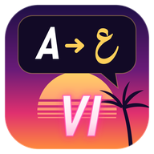

<p align="center">
  
</p>

<h1 align="center">VI Translator - Android TV</h1>

<p align="center">VI Translator's live subtitles on your Android TV, over the game from your console.</p>

---

## What it does

Shows VI Translator's translations on your TV, over the game from your console's HDMI input. It
needs a TV that runs Google TV or Android TV itself (for example TCL, Sony, Hisense or Philips
Google TV models), with the console plugged into the TV.

## How it works

1. The console goes into a capture card with passthrough, and the card's passthrough goes into the
   TV, so the game reaches the TV with no delay.
2. VI Translator on the PC reads the subtitles from the capture card and translates them.
3. This app shows the translations over the TV picture, where they would be on the game picture.
   Only the text crosses your home network, so it shows as fast as on the PC.

The overlay never takes the remote: it keeps working the TV and the game under it.

## Setup

1. **Install the app on the TV:** copy the APK to the TV, for example with the *Downloader* app or
   with `adb install`.
2. **Open it:** it shows a 6-digit code. It keeps waiting for 10 minutes after you leave it, so
   you can switch the TV to the PC's input if the PC is on the same TV.
3. **On the PC:** in VI Translator, *Source* tab, *Show on a TV*, *Connect a TV*. Type the code and
   press *Connect*. Sharing on the home network is turned on if it was off.
4. **Allow it to draw over other apps** if the app asks. If the TV has no such setting (some TCL
   models hide it), allow it once from a computer, with developer options and USB or network
   debugging on:

   ```sh
   adb connect <TV address>
   adb shell appops set app.vitranslator.tv SYSTEM_ALERT_WINDOW allow
   ```

Once connected, the app shows the connection and two buttons:

- **Show on:** all inputs, or one HDMI input only (the console's): the overlay then hides on the
  home screen, in apps and on other inputs. Offered on TVs that tell apps which input is on screen
  (TCL); elsewhere the overlay shows everywhere.
- **Disconnect:** the TV forgets the PC and shows a new code. Removing the TV in VI Translator on
  the PC does the same.

The overlay comes back by itself when the TV turns on, and finds the PC again if the router gives
it a new address.

## Tips

- Show the game full screen with no zoom or overscan (picture size *Auto* or *Just scan*), so the
  translations land where the PC expects.
- The text style, the language and what is read are all set in VI Translator on the PC.

## Build

Needs JDK 17 or newer and the Android SDK (platform 36), or open the folder in Android Studio:

```sh
./gradlew assembleDebug     # app/build/outputs/apk/debug/app-debug.apk
```

## Credits

The Changa font is under the SIL Open Font License (`FONT-LICENSE-Changa.txt`).
